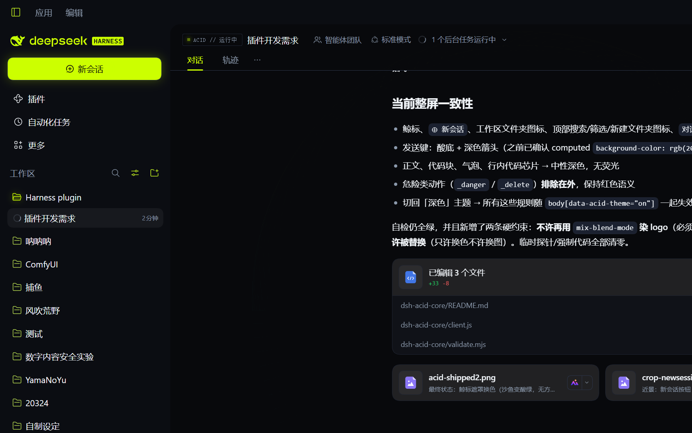
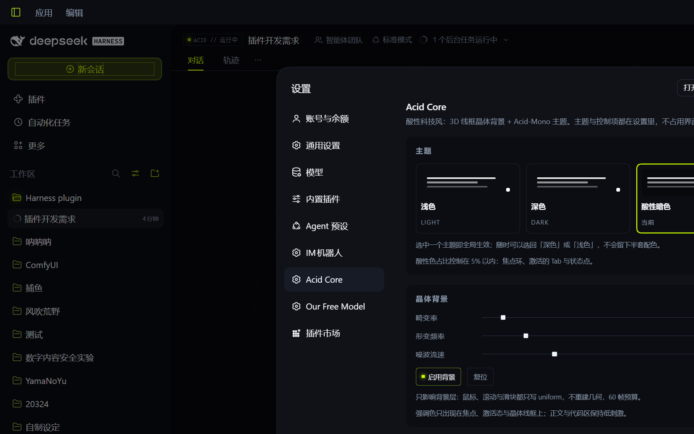

# DSH plugins

DeepSeek Harness（DSH）Web 客户端插件合集。每个插件都是**零依赖、零构建步骤**的纯 JS 包，通过 DSH 的 manifest（`dsh.bundle.patch` + `dsh.client`）挂载，改完保存即热生效。

| 插件 | 作用 |
|---|---|
| [`dsh-acid-core`](dsh-acid-core/) | 酸性科技风：WebGL 线框晶体背景 + Acid-Mono 完整主题 + 设置页控制面板 |
| [`dsh-composer-meter`](dsh-composer-meter/) | 输入框下方实时字数与 token 估算 |

## 截图

酸性主题（Acid Mono）下的品牌带、侧栏与设置页：

| 品牌带 | 侧栏控件 |
|---|---|
|  |  |

| Acid Core 设置页 |
|---|
|  |

## 安装

插件是**目录链接**安装，改代码即时生效，不需要重新打包。两种方式：

**A. 用 DSH 图形界面（推荐）**

设置 → 插件 → 添加插件 → 填插件目录的绝对路径，例如：

```
D:\Harness plugin\dsh-acid-core
```

**B. 命令行（等价于插件管理器做的事）**

```powershell
node tools\install-profile.mjs --dry-run   # 看会改哪些文件
node tools\install-profile.mjs             # 装进当前 desktop profile
node tools\install-profile.mjs --revert    # 还原 manifest 并删除链接
```

它会往 `~/.dsh/profiles/<name>/package.json` 加 `link:` 依赖 + bundle 行，并在 `node_modules` 建目录链接——不跑 pnpm，不动已加载的模块。

## 自检

每个插件都带一个离线自检脚本（不需要 DSH、不需要浏览器）：

```powershell
cd dsh-acid-core
node validate.mjs
```

它用一个 stub 的 `window.__ModuleLoader__` + stub React 跑一遍真实加载路径，断言：manifest 字段、插件契约（`inject: []`）、slot 注册、主题 token 的完整性与对比度（WCAG）、几何不变量、参数钳制、以及组件渲染树。**不覆盖** WebGL 实际输出与视觉观感。

## 设计约束（为什么长这样）

- **不阻塞首屏**：没有 `setTimeout` / `setInterval`（自检强制），动画只是一层 click-through 画布。
- **60 Hz 预算**：165Hz 屏也按 1/61 跳帧；DPR 上限 1.25；掉到 45fps 以下降一档像素比，不重建几何。
- **正文零干扰**：晶体在 shader 里按正文栏做 alpha 遮罩，且会话一有内容就自动退到 0.24 透明度。
- **可逆**：主题、背景、主题色层都能一键关掉，关掉后界面完全还原。
- **不猜 token 语义**：`--dsw-alias-markdown-inline-code` 是**背景色**不是字色——这类错误靠 `tools/token-usage.mjs` 扫描实际消费属性来避免。

## 目录

```
dsh-acid-core/          # 晶体背景 + 主题 + 设置页
dsh-composer-meter/     # 输入框计量
tools/
  install-profile.mjs   # 安装/回滚到 DSH profile
  build-acid-theme.mjs  # 从 dsh 内置深色板重新生成主题基座
  token-usage.mjs       # token 消费属性盘点
  find-rule.mjs         # 按关键字/ token 反查 CSS 规则
docs/screenshots/       # README 用图
```

## License

MIT
